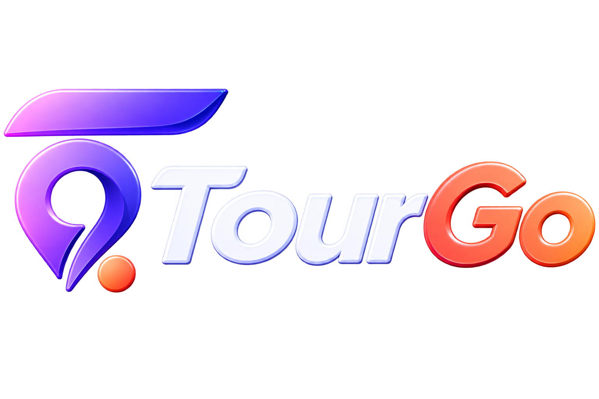

<div align="center">



### Your journey. Your choices. Our support.

**A smarter way to discover, plan, and experience Sri Lanka.**

</div>

---

## About TourGo

TourGo is a Sri Lankan travel technology platform designed to make independent travel simpler, more transparent, and more connected.

Instead of forcing travellers into fixed tour packages, TourGo is being built around a simple idea:

> **Let travellers build the journey they want while connecting them directly with the local services they need.**

The platform brings travellers, safari drivers, hotels, and other tourism service providers into one connected digital ecosystem.

Our goal is to make travelling across Sri Lanka easier for visitors while creating more direct opportunities for local tourism businesses and service providers.

---

## What TourGo Offers

### Safari Experiences

Travellers can discover safari experiences and drivers for some of Sri Lanka's major wildlife destinations, including:

* Yala
* Udawalawe
* Wilpattu
* Minneriya

TourGo is designed to provide clear safari options while allowing travellers to compare and select services based on their own requirements.

### Hotels

TourGo provides a platform where accommodation providers from across Sri Lanka can list their properties and reach travellers directly.

Travellers can discover and filter hotels based on factors such as:

* Destination and location
* Nearby locations
* Price range
* Property type
* Facilities and amenities
* Guest requirements

### Driver Discovery

Travellers can discover safari drivers through dedicated driver profiles containing relevant information about the driver and vehicle.

The platform is designed to support both established and newly registered drivers while maintaining transparent visibility for promoted listings.

### Independent Journey Planning

TourGo is evolving beyond individual bookings into a platform where travellers can build their own Sri Lankan journey.

```text
Choose Travel Dates
        ↓
Select Destinations
        ↓
Plan the Route
        ↓
Discover Hotels
        ↓
Find Safari Experiences
        ↓
Manage the Journey
```

The traveller remains in control of the trip instead of being restricted to a predefined tour package.

---

## Built for Travellers and Local Tourism

TourGo is designed as a two-sided tourism ecosystem.

```text
                     TourGo
                        │
          ┌─────────────┴─────────────┐
          │                           │
      Travellers                Local Partners
          │                           │
    ┌─────┼─────┐              ┌─────┴─────┐
    │     │     │              │           │
 Hotels Safari Journey      Drivers      Hotels
             Planning
```

### For Travellers

TourGo aims to provide:

* Greater freedom when planning a trip
* Transparent service discovery
* Direct access to local tourism providers
* Centralized booking management
* Location-based discovery
* A simpler way to organize multiple parts of a Sri Lankan journey

### For Tourism Partners

TourGo provides local partners with opportunities to:

* Build their digital presence
* Reach international and local travellers
* Manage their service information
* Receive booking opportunities
* Manage availability
* Track bookings and activity
* Promote their services through clearly identified promotional placements

---

## Platform Ecosystem

TourGo is being developed across multiple applications and services.

| Component           | Purpose                         | Technology        |
| ------------------- | ------------------------------- | ----------------- |
| TourGo Web          | Traveller-facing web platform   | React + Vite      |
| TourGo Mobile       | Mobile traveller experience     | Flutter           |
| TourGo Backend      | Core APIs and business services | Spring Boot       |
| PostgreSQL Database | Platform data persistence       | PostgreSQL / Neon |
| Partner Dashboards  | Hotel and driver management     | TourGo Platform   |

---

## Core Platform Areas

```text
TourGo
│
├── Traveller Experience
│   ├── Destination Discovery
│   ├── Safari Discovery
│   ├── Hotel Discovery
│   ├── Driver Profiles
│   ├── Search & Filtering
│   ├── Booking Management
│   └── Journey Planning
│
├── Safari Driver Platform
│   ├── Driver Profile
│   ├── Vehicle Information
│   ├── Ride Requests
│   ├── Upcoming Rides
│   ├── Availability
│   ├── Earnings & Payments
│   ├── Reviews
│   └── Promotions
│
├── Hotel Partner Platform
│   ├── Property Listings
│   ├── Location Information
│   ├── Facilities
│   ├── Availability
│   ├── Listing Management
│   └── Promotional Placement
│
└── Platform Services
    ├── Authentication
    ├── Verification
    ├── Notifications
    ├── Payments & Settlements
    ├── Search
    └── Partner Management
```

---

## Technology

TourGo uses a modern multi-platform architecture.

### Frontend

* React
* Vite
* JavaScript
* Responsive Web Design

### Mobile

* Flutter
* Dart
* Android
* iOS

### Backend

* Java
* Spring Boot
* REST APIs

### Data

* PostgreSQL
* Neon PostgreSQL

### Development & Infrastructure

* Git
* GitHub
* GitHub Actions
* RESTful API architecture
* TLS-secured production communication

---

## Design System

TourGo uses a consistent visual identity across its applications.

| Role                 | Colour    |
| -------------------- | --------- |
| Primary              | `#7956E8` |
| Primary Light        | `#B98AF5` |
| Primary Deep         | `#4E36A8` |
| Accent               | `#E98B78` |
| Background           | `#FCFBFF` |
| Secondary Background | `#F7F4FF` |
| Surface              | `#FFFFFF` |
| Primary Text         | `#17142B` |
| Secondary Text       | `#716C80` |
| Border               | `#E9E5F1` |

---

## Our Direction

TourGo is being developed around four principles:

**Choice** — Travellers should control how their journey is planned.

**Transparency** — Listings, promotions, prices, and service information should be clearly presented.

**Local Opportunity** — Independent drivers, hotels, and tourism businesses should have opportunities to reach travellers digitally.

**Connected Travel** — Different parts of a journey should work together instead of requiring travellers to manage everything across disconnected services.

---

## Project Status

> **TourGo is currently under active development.**

Features, architecture, interfaces, and platform capabilities are continuously being developed and refined.

---

<div align="center">

### TourGo

**Your journey. Your choices. Our support.**

Built in Sri Lanka for travellers exploring Sri Lanka.

</div>
